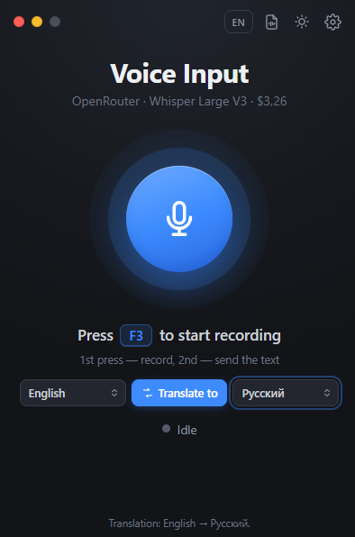
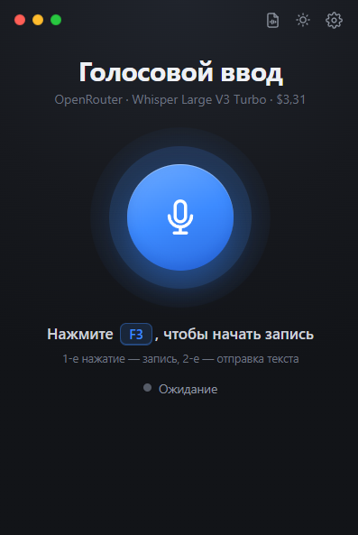
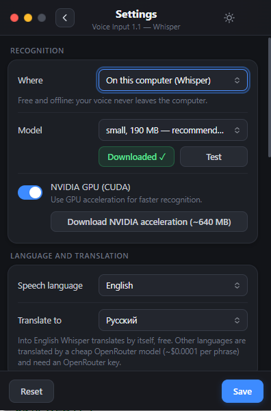
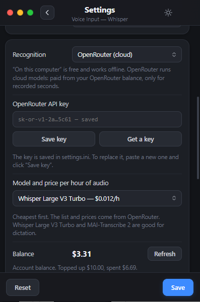

# VoiceDictate — voice typing and translator for Windows 10 and 11

[Русский](README.md) · **English**

**Version 1.3** — [download](https://github.com/gemini1978v-beep/VoiceDictate/releases/latest) · [what's new](https://github.com/gemini1978v-beep/VoiceDictate/releases/tag/v1.3) · [website](https://gemini1978v-beep.github.io/VoiceDictate/)

Press **F3**, say a phrase, press **F3** again, and the text is pasted wherever your cursor is:
a chat, Notepad, a browser, Word, a messenger. Handles punctuation, works great with English,
Russian and many other languages.

**Features:**

- **Recognition on your computer** with Whisper (whisper.cpp): free, offline,
  your audio never leaves the PC. NVIDIA GPU acceleration is supported.
- **GigaAM v3 model by Sber** for Russian speech (via [sherpa-onnx](https://github.com/k2-fsa/sherpa-onnx)):
  also local and offline, adds punctuation by itself, recognizes a phrase in a fraction
  of a second on an ordinary CPU.
- **Phrase-by-phrase insertion** (with GigaAM): keep talking — after each short pause the phrase
  appears in the window right away while recording goes on.
- **Recognition in the cloud** via [OpenRouter](https://openrouter.ai), if your PC is slow
  or you want a more accurate model. The app shows models with their price per hour of audio
  (from ~$0.012/h for Whisper Large V3 Turbo) and your balance.
- **Three ways to capture audio**: direct, through the built-in web engine, or through a tab
  in your regular browser. The last one helps when a corporate antivirus (e.g. Kaspersky)
  blocks microphone access for programs.
- **Translator:** speak one language — a translation into another is pasted. The “Translate to”
  button and language lists are right on the main screen. Whisper translates into English by itself
  (free on your computer); 35 other languages are translated by a cheap OpenRouter model (~$0.0001 per phrase).
- **Transcribe audio and video files** to `.txt` text and `.srt` subtitles.
- English and Russian interface (RU/EN switch on the main screen); recognizes English,
  Russian and other languages.
- Runs from the tray, configurable hotkey, light and dark themes.

Windows voice typing (Win+H) is not needed, so everything works on **Windows 10** too.

## Screenshots

<p>
  
  
</p>

Settings show only the selected mode: on your computer (Whisper or GigaAM model, NVIDIA GPU)
or in the OpenRouter cloud (key, model with price per hour, balance).

<p>
  
  
</p>

## Quick start

### Option 1. Ready-to-use program (easiest)

1. Open the **Releases** page of this repository and download `VoiceDictate-win-x64.zip`.
2. Unpack it, for example to `C:\VoiceDictate`. Use a path with **Latin letters only**:
   whisper cannot open files in paths with other alphabets.
3. Run `VoiceDictate.exe`. If Windows shows “Windows protected your PC”, click
   “More info” → “Run anyway” (the program is not code-signed).
4. Click **RU/EN** at the top to switch the interface language if needed.
5. Choose where to recognize speech:
   - **on your computer** (selected by default) — open Settings (gear icon), click **“Download”**
     next to the model (once), then **“Test”**. **GigaAM v3** (220 MB) is selected by default — the best
     for Russian, it can insert text phrase by phrase. For other languages and translation into English
     pick a Whisper model (small, 190 MB) in the same list;
   - **in the cloud** — in Settings, “Recognition” → “OpenRouter (cloud)”, paste your API key
     (the “Get a key” button), pick a model, click **“Test”**.
6. In Settings, set **“Speech language”** to the language you speak.
7. Click into any text field, press **F3**, say a phrase, press **F3** again.

If the volume bar does not move, see [“Troubleshooting on Windows 10”](#troubleshooting-on-windows-10)
and the [“Audio capture”](#settings) setting.

### Option 2. Build from source

1. Get the repository (`git clone` or Code → Download ZIP) and unpack it to a path
   with Latin letters only.
2. Double-click `build.bat`. If the .NET SDK is missing, it installs it via winget (once)
   and builds the program into the `dist` folder.
3. Continue from step 3 of option 1, running `dist\VoiceDictate.exe`.

## How it works

One key — **F3** (you can change it in the window).

1. **F3** — recording starts, the indicator turns **green**.
   The window you are working in (chat, Notepad, browser) stays active.
   The bar next to the microphone shows the volume.
2. **F3 again** — the indicator turns **red**, the recording goes to Whisper.
   A couple of seconds later the text appears in the program field and is pasted
   into the active window right away. The field is cleared.

If the program itself is active when sending, the text goes to the window
you were in before.

**Esc** while recording cancels it: the microphone turns off, the recording is discarded
and nothing is pasted.

The voice recording is kept only in the `temp` folder next to the program: each new
recording overwrites the previous one, and the folder is cleared when the program closes.

### Phrase-by-phrase insertion (GigaAM model)

With the GigaAM model you do not have to wait for the second press: keep talking,
and after each pause of about 0.6 s the phrase is recognized and pasted into the window
right away while recording goes on. The second **F3** press inserts the last phrase
and stops recording. If “Press Enter” is on, Enter is pressed once at the end —
a messenger gets a single message.

A phrase goes to the window that is active at the moment of the pause, so do not
switch windows while dictating. To turn it off, clear “Insert phrase by phrase”
in Settings (`live_phrases = no` in `settings.ini`).

## Interface

The window is drawn with HTML/CSS (`ui\index.html`) and shown through
**WebView2** — the Edge engine built into Windows 10/11.

- Main screen: a big microphone button (same as F3), status, hint.
  Blue — idle, green — recording (the rings “breathe” with the volume),
  orange — recognizing.
- Gear at the top right — settings in the same window (Esc or “‹” — back).
  The log is at the bottom of the settings. “Save” applies a new hotkey.
- Circles at the top left: red — close, yellow — minimize to tray,
  green — “always on top” (grey — off).
- Drag the window by any empty area.
- When minimized (yellow circle or taskbar button), the window hides in the tray next to the clock,
  F3 works as usual. Tray icon color: blue — idle, green — recording,
  orange — recognizing. Click the icon to open the window, right-click — “Exit”.
- Moon/sun next to the gear — dark/light theme (remembered).
- **RU/EN** button — interface language (remembered; `ui_lang` in `settings.ini`).
- Only one copy runs: starting the exe again just shows the open window
  (including from the tray).
- If you turn off “Send recognized text…”, the main screen shows a text field
  with a “Send” button.

You can tweak the design without rebuilding: `dist\ui\index.html` is a regular page;
open it in Chrome/Edge (it runs in demo mode there), edit the CSS
and restart the program.

If WebView2 is missing (rare, on old Windows 10), the program opens
the classic window and puts a link to the WebView2 Runtime installer in the log:
https://go.microsoft.com/fwlink/p/?LinkId=2124703 .
To force the classic window: `ui = classic` in `settings.ini`.

## Transcribe an audio or video file

The page icon next to the moon/sun opens the “Transcribe file” window
(or just drag a file onto the main window).

1. Drag a file into the window or click “Choose file”.
2. “Transcribe” — shows progress in percent and the estimated time left.
3. Done: `name.txt` appears next to the source file (text in paragraphs).
   With “Also .srt subtitles” on, you also get `name.srt` with timestamps.
   If that folder is not writable, the file is saved to “Documents\VoiceDictate”.

Formats:
- **WAV, MP3, FLAC, OGG** — work right away.
- **M4A, AAC, OPUS, WMA and any video** (MP4, MKV, AVI, MOV, WEBM…) — need
  the free **ffmpeg** converter. The “Download ffmpeg” button downloads it
  once (~100 MB) into the `ffmpeg` folder next to the program. If ffmpeg is already
  installed on the system, the program finds it. Manually: put
  `ffmpeg.exe` into `dist\ffmpeg\`.

The model and language are the same as in the main window settings. F3 keeps working
while a file is being transcribed.

## Installing from source in detail

1. Unpack the archive, for example to `C:\VoiceDictate`.
   Use a path with **Latin letters only**: whisper cannot open files in other paths.
2. Double-click `build.bat`. It builds the program into the `dist` folder
   (if the .NET SDK is missing, it installs it via winget, once).
   You get:
   ```
   dist\
     VoiceDictate.exe
     settings.ini
     download-model.bat
     ui\             ← interface (HTML/CSS), editable
     ffmpeg\         ← appears after “Download ffmpeg” (for video and M4A/AAC/OPUS/WMA)
     whisper\        ← whisper.cpp 1.9.2 + required DLLs (included)
     models\         ← the model is downloaded here
   ```
3. Run `dist\VoiceDictate.exe`, choose a model and click **“Download”**
   (once). Recommended: **small, 190 MB**.
4. Click **“Test”** — the program recognizes a test recording.
   The log should show the recognized Russian test phrase “Привет! Это проверка распознавания речи…”.
5. Test the microphone: click into Notepad, press F3, say a phrase
   (the volume bar should move), press F3 again.

### If the “Download” button did not work

- Run `dist\download-model.bat` — it downloads the same model with curl.
- Or download the file in your browser and put it into `dist\models\`:
  - small (recommended): https://huggingface.co/ggerganov/whisper.cpp/resolve/main/ggml-small-q5_1.bin
  - large-v3-turbo (more accurate, slower): https://huggingface.co/ggerganov/whisper.cpp/resolve/main/ggml-large-v3-turbo-q5_0.bin
  - if huggingface.co does not open — the same files are on hf-mirror.com
    (replace `huggingface.co` with `hf-mirror.com` in the link).
  - GigaAM v3: put `encoder.int8.onnx`, `decoder.onnx`, `joiner.onnx`, `tokens.txt` from
    https://huggingface.co/csukuangfj/sherpa-onnx-nemo-transducer-punct-giga-am-v3-russian-2025-12-16/tree/main
    into the `dist\models\gigaam-v3-ru\` folder.

  Then restart the program — the model appears in the list with a check mark.

## Which model to choose

| Model | Size | Quality |
|---|---|---|
| base | 60 MB | fast, but makes noticeable mistakes |
| **small** | 190 MB | good — **start with this one** |
| medium | 515 MB | better, slower |
| large-v3-turbo | 550 MB | best, 2–3 times slower than small |
| **GigaAM v3** | 220 MB | Russian only; more accurate and much faster than Whisper on a CPU, adds punctuation by itself |

The log shows how many seconds recognition takes. If small gets words wrong,
try large-v3-turbo or, for Russian speech, GigaAM.

How GigaAM differs from Whisper:
- it understands **Russian only** — other languages need Whisper;
- it does not translate into English by itself: with GigaAM, translation is done by an OpenRouter model (needs a key);
- it does not need a GPU; the model stays in memory for 5 minutes after recognition, then frees it;
- audio and video files are still transcribed by Whisper;
- it can insert text phrase by phrase while you are still recording.

## Troubleshooting on Windows 10

1. “Test” passed → whisper and the model work.
2. The volume bar does not move / the log says “complete silence”:
   **Settings → Privacy → Microphone** — turn on
   “Allow apps to access your microphone” and below it
   “Allow desktop apps to access your microphone”.
   Pick the right microphone in the program.
   If an antivirus blocks the microphone, choose **“Audio capture: via browser”**.
3. “missing DLL” — install Microsoft Visual C++ Redistributable x64:
   https://aka.ms/vs/17/release/vc_redist.x64.exe
   (the required DLLs are already in the whisper folder, so this is usually not needed).
4. “the CPU lacks required instructions” — a very old CPU;
   open an issue and a different whisper build can be picked.
5. In windows running as administrator, pasting works only if
   the program also runs as administrator.

## Settings

- **Hotkey** — click the field, press a combination, “Save”.
- **Model / Download / Test** — see above.
- **Microphone** — which microphone to record.
- **Audio capture** — where the sound comes from, if an antivirus (e.g. Kaspersky) blocks it for programs:
  - “Direct” — the classic way;
  - “Via web” — the Edge engine built into the window opens the microphone;
  - “Via browser” — your regular browser opens the microphone. The program opens the tab
    `http://127.0.0.1:47811/`: click “Connect microphone” there, allow access and keep
    the tab open; recording is still started with F3.

  In `settings.ini`: `mic_source = direct / web / browser`.
- **Speech language** — the language you speak: English, Russian, Ukrainian and others,
  or “Auto-detect”. In `settings.ini`: `language = en / ru / auto…`.
- **Translate to** — translate the recognized text into the selected language (same as the button on the
  main screen). Whisper translates into English; other languages use an OpenRouter model and need a key.
  In `settings.ini`: `translate = yes / no`, `translate_to`, `translate_model` (default `openai/gpt-4o-mini`).
- **Insert phrase by phrase** (GigaAM only) — paste each phrase after a pause without waiting
  for the second press. In `settings.ini`: `live_phrases = yes / no`.
- **Recognition** — “On this computer” (Whisper or GigaAM), free and offline, or “OpenRouter (cloud)”:
  the recording is sent to a cloud model via [OpenRouter](https://openrouter.ai) and paid from
  your OpenRouter balance per second of audio. An API key is required (the “Get a key” button).
  Models and prices per hour come from OpenRouter, cheapest first. OpenRouter shows the account
  balance only to a Management key; with a regular key the program shows what the key has spent
  or its remaining limit.
  In `settings.ini`: `engine = local / openrouter`, `openrouter_key`, `openrouter_model`.
  The “Transcribe file” window still runs on your computer.
- **Send recognized text right away** — when off, the text stays in the field,
  you can edit it and click “Send”.
- **Press Enter after pasting + delay** — e.g. 0.2 s.
- **Type character by character** — if Ctrl+V does not work in the target window.
- **Window always on top**.

In `settings.ini` you can also change the Whisper prompt (`prompt` — sample text in the
desired style, helps with punctuation).

## NVIDIA GPU acceleration

1. Click **“Download NVIDIA acceleration (~640 MB)”** — the program downloads
   whisper.cpp with CUDA and unpacks it into the `whisper-cuda` folder (≈1.1 GB on disk).
2. The **“NVIDIA GPU (CUDA)”** switch turns it on (off — CPU).
3. Click **“Test”**. The log should say
   `Test passed in … s (GPU NVIDIA GeForce …)`.
   If it says “CPU”, update your NVIDIA driver.

- **RTX 30xx / 40xx** (e.g. 3080) — works right away.
- **RTX 50xx** (e.g. 5070 Ti): the **first** test may take a few minutes —
  the driver prepares code for the new GPU. After that it is fast (the code is cached).
  A recent driver (570 or newer) is required.
- On a GPU, go for **large-v3-turbo** — the most accurate model, and it still
  recognizes almost instantly.

Manually: download https://github.com/ggml-org/whisper.cpp/releases/download/v1.9.2/whisper-cublas-12.4.0-bin-x64.zip,
put the files from its `Release` folder into `dist\whisper-cuda`, and copy `*.dll` from `dist\whisper` there too.

## What's inside

- `whisper\` — whisper.cpp 1.9.2 for Windows x64 (MIT license,
  `LICENSE-whisper.cpp.txt`), Visual C++ Runtime libraries
  and the test recording `test-ru.wav`.
- [sherpa-onnx](https://github.com/k2-fsa/sherpa-onnx) (Apache 2.0) with ONNX Runtime (MIT) — for the
  [GigaAM](https://github.com/salute-developers/GigaAM) model (MIT); the model itself is downloaded with the “Download” button.
- Microphone recording uses the standard WinAPI (winmm), no third-party libraries.

## For developers

- C# / .NET 8, WinForms + WebView2. Build: `build.bat` (or
  `dotnet publish VoiceDictate.csproj -c Release -r win-x64 --self-contained true -p:PublishSingleFile=true -o dist`).
- `MainForm*.cs` — main window and logic: recording, recognition, pasting text, tray.
- `Recorder.cs` — WinAPI recording; `WebRecorder.cs` — recording through the window page;
  `BrowserMic.cs` + `ui\mic.html` — recording through a browser tab (server on 127.0.0.1:47811 only).
- `WhisperEngine.cs` — runs whisper.cpp and downloads models; `SherpaEngine.cs` — the GigaAM model
  via sherpa-onnx; `MainForm.Live.cs` — pause detection and phrase-by-phrase insertion; `OpenRouter.cs` — cloud
  recognition, model list with prices, balance.
- `FileForm.cs`, `FileTranscriber.cs`, `ui\files.html` — the “Transcribe file” window.
- `ui\index.html` — the main window interface; opened directly in a browser, it runs in demo mode.
- `Lang.cs` — interface language; strings are translated in place with `L.T("русский", "English")`,
  pages use `data-en` attributes.
- `settings.ini` — default settings. Do not commit your own OpenRouter key.

## License

[MIT](LICENSE) — free to use, modify and distribute as long as the copyright notice is kept.
whisper.cpp in the `whisper\` folder is MIT-licensed too (`whisper\LICENSE-whisper.cpp.txt`),
sherpa-onnx is Apache 2.0, the GigaAM model is MIT.
