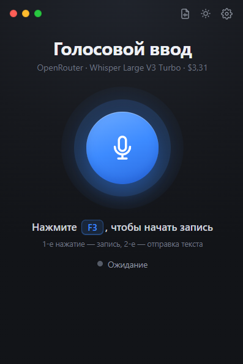
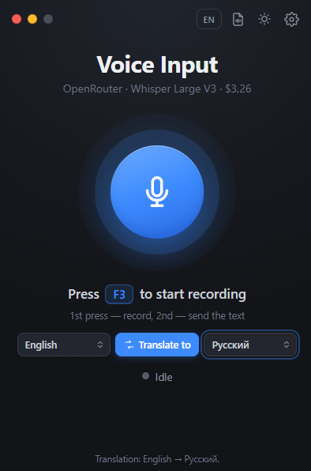
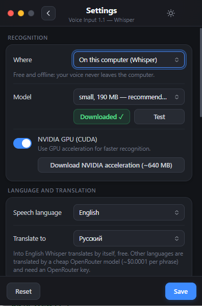
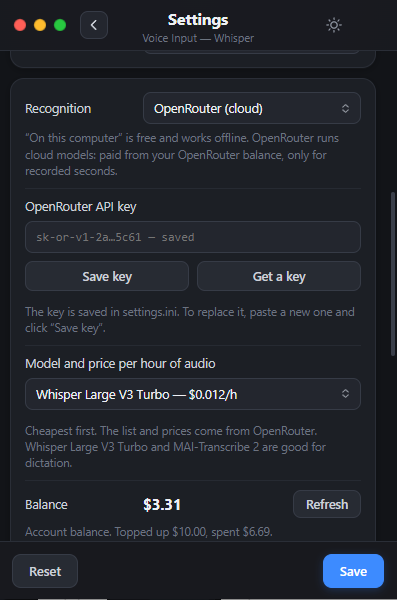

# VoiceDictate — голосовой ввод и переводчик для Windows 10 и 11

**Русский** · [English](README.en.md)

**Версия 1.5** — [скачать](https://github.com/gemini1978v-beep/VoiceDictate/releases/latest) · [что нового](https://github.com/gemini1978v-beep/VoiceDictate/releases/tag/v1.5) · [сайт](https://gemini1978v-beep.github.io/VoiceDictate/ru/)

Нажали **F3**, сказали фразу, снова нажали **F3**, и текст сам вставился туда, где стоит курсор:
в чат, Блокнот, браузер, Word, мессенджер. Хорошо понимает русский, расставляет знаки препинания.

**Возможности:**

- **Распознавание на компьютере** через Whisper (whisper.cpp): бесплатно, без интернета,
  запись никуда не уходит. Есть ускорение на видеокартах NVIDIA.
- **Модель GigaAM v3 от Сбера** для русской речи (через [sherpa-onnx](https://github.com/k2-fsa/sherpa-onnx)):
  тоже на компьютере и без интернета, сама ставит знаки препинания, на обычном процессоре
  распознаёт фразу за доли секунды.
- **Вставка по фразам** (с GigaAM): говорите не останавливаясь — после каждой короткой паузы
  фраза сразу появляется в окне, а запись продолжается.
- **Распознавание в облаке** через [OpenRouter](https://openrouter.ai), если компьютер слабый
  или нужна точнее модель. В программе видны модели с ценой за час записи
  (от ~$0,012/ч у Whisper Large V3 Turbo) и баланс.
- **Три способа записи звука**: напрямую, через встроенный веб-движок или через вкладку
  обычного браузера. Последний выручает, если корпоративный антивирус (например, Касперский)
  не даёт программам доступ к микрофону.
- **Переводчик:** говорите на одном языке — в окно вставляется перевод на другой. Кнопка
  «Перевести на» и выбор языков прямо на главном экране. На английский переводит сам Whisper
  (на компьютере бесплатно), на 35 других языков — недорогая модель OpenRouter (~$0,0001 за фразу).
- **Распознавание аудио- и видеофайлов** в текст `.txt` и субтитры `.srt`.
- Интерфейс на русском и английском (переключатель RU/EN на главном экране),
  распознаёт русский, английский и другие языки.
- Работает из трея, горячая клавиша настраивается, светлая и тёмная тема.
- **Обновляется сама:** когда выходит новая версия, на главном экране появляется кнопка
  «Обновить» — программа скачает её, заменит свои файлы (настройки и модели сохранятся)
  и перезапустится.

Голосовой ввод Windows (Win+H) не нужен, поэтому всё работает и на **Windows 10**.

## Как выглядит

<p>
  
  
</p>

Настройки показывают только выбранный режим: распознавание на компьютере (модель Whisper или GigaAM, видеокарта NVIDIA)
или в облаке OpenRouter (ключ, модель с ценой за час, баланс).

<p>
  
  
</p>

## Быстрый старт

### Вариант 1. Готовая программа (проще)

1. Откройте страницу **Releases** этого репозитория и скачайте `VoiceDictate-win-x64.zip`.
2. Распакуйте, например, в `C:\VoiceDictate`. Лучше в путь **без русских букв**:
   whisper не открывает файлы по таким путям.
3. Запустите `VoiceDictate.exe`. Если Windows покажет «Система Windows защитила ваш компьютер» —
   нажмите «Подробнее» → «Выполнить в любом случае» (программа не подписана сертификатом).
4. Выберите, где распознавать:
   - **на компьютере** (выбрано сразу) — откройте настройки (шестерёнка), нажмите **«Скачать»**
     у модели (один раз), затем **«Проверить»**. Сразу выбрана **GigaAM v3** (220 МБ) — лучшая для
     русского, умеет вставлять текст по фразам. Для других языков и перевода на английский
     выберите в том же списке модель Whisper (small, 190 МБ);
   - **в облаке** — в настройках «Распознавание» → «OpenRouter (облако)», вставьте ключ API
     (кнопка «Где взять ключ»), выберите модель, нажмите **«Проверить»**.
5. Встаньте в любое текстовое поле, нажмите **F3**, скажите фразу, нажмите **F3** ещё раз.

Если полоска громкости не двигается — смотрите раздел
[«Проверка на Windows 10 — чек-лист»](#проверка-на-windows-10--чек-лист)
и настройку [«Запись звука»](#настройки-в-окне).

### Вариант 2. Собрать из исходников

1. Скачайте репозиторий (`git clone` или кнопка Code → Download ZIP) и распакуйте в путь
   без русских букв.
2. Дважды щёлкните `build.bat`. Если .NET SDK нет, он поставит его через winget (один раз)
   и соберёт программу в папку `dist`.
3. Дальше как в варианте 1 с пункта 3, только запускайте `dist\VoiceDictate.exe`.

## Как работает

Одна клавиша — **F3** (можно сменить в окне).

1. **F3** — начинается запись с микрофона, индикатор горит **зелёным**.
   Окно, в котором вы работаете (чат, Блокнот, браузер), остаётся активным.
   Полоска рядом с микрофоном показывает громкость.
2. **F3 ещё раз** — индикатор **красный**, запись уходит в Whisper.
   Через пару секунд текст появляется в поле программы и сразу вставляется
   в активное окно. Поле очищается.

Если в момент отправки активна сама программа, текст уйдёт в окно,
где вы были перед этим.

**Esc** во время записи — отменить её: микрофон выключается, запись выбрасывается,
ничего не вставляется.

Запись голоса хранится только во временной папке `temp` рядом с программой: каждая
новая запись затирает предыдущую, а при закрытии программы папка очищается.

### Вставка по фразам (модель GigaAM)

С моделью GigaAM не нужно ждать второго нажатия: говорите не останавливаясь,
и после каждой паузы около 0,6 с сказанная фраза распознаётся и сразу вставляется
в окно, а запись продолжается. Второе нажатие **F3** вставляет последнюю фразу
и выключает запись. Если включено «Нажимать Enter», Enter нажимается один раз
в конце — в мессенджер уйдёт одно сообщение.

Фраза вставляется в окно, активное в момент паузы, поэтому во время диктовки
не переключайтесь между окнами. Выключить: в настройках снимите
«Вставлять по фразам» (в `settings.ini` — `live_phrases = no`).

## Интерфейс

Окно нарисовано на HTML/CSS (файл `ui\index.html`) и показывается через
**WebView2** — встроенный в Windows 10/11 движок Edge. Логика программы та же.

- Главный экран: большая кнопка микрофона (то же, что F3), статус, подсказка.
  Синяя — ожидание, зелёная — идёт запись (круги «дышат» от громкости),
  оранжевая — распознавание.
- Шестерёнка справа вверху — настройки в том же окне (Esc или «‹» — назад).
  Ниже в настройках — журнал. «Сохранить» применяет новую горячую клавишу.
- Кружки слева вверху: красный — закрыть, жёлтый — свернуть в трей,
  зелёный — «поверх остальных окон» (серый — выключено).
- Окно перетаскивается за любое пустое место.
- Свернули (жёлтый кружок или кнопка на панели задач) — окно прячется в трей у часов,
  F3 работает как обычно. Цвет значка в трее: синий — ожидание, зелёный — запись,
  оранжевый — распознавание. Щелчок по значку — открыть окно, правая кнопка — «Выход».
- Луна/солнце рядом с шестерёнкой — тёмная/светлая тема (запоминается).
- Кнопка **RU/EN** — язык интерфейса (запоминается, в `settings.ini` — `ui_lang`).
- Запускается только одна копия: повторный запуск exe просто показывает уже открытое окно
  (в том числе из трея).
- Если отключить «Сразу отправлять…», на главном экране появляется поле
  с текстом и кнопкой «Отправить».

Дизайн можно править без пересборки: `dist\ui\index.html` — обычная страница,
её можно открыть в Chrome/Edge (там она работает в демо-режиме), поправить CSS
и перезапустить программу.

Если WebView2 нет (редко, на старой Windows 10), программа сама откроется
в старом окне и напишет в журнале ссылку на установку WebView2 Runtime:
https://go.microsoft.com/fwlink/p/?LinkId=2124703 .
Принудительно старое окно: в `settings.ini` строка `ui = classic`.

## Распознать аудио- или видеофайл

Кнопка с листком рядом с луной/солнцем открывает окно «Распознать файл»
(или просто перетащите файл на главное окно).

1. Перетащите файл в окно или нажмите «Выбрать файл».
2. «Распознать» — идёт прогресс в процентах и примерное оставшееся время.
3. Готово: рядом с исходным файлом появляется `имя.txt` (текст абзацами).
   Если включить «Ещё и субтитры .srt» — ещё и `имя.srt` с таймкодами.
   Если в ту папку писать нельзя — файл сохранится в «Документы\VoiceDictate».

Форматы:
- **WAV, MP3, FLAC, OGG** — работают сразу.
- **M4A, AAC, OPUS, WMA и любое видео** (MP4, MKV, AVI, MOV, WEBM…) — нужен
  бесплатный конвертер **ffmpeg**. Кнопка «Скачать ffmpeg» в окне скачает его
  один раз (~100 МБ) в папку `ffmpeg` рядом с программой. Если ffmpeg уже
  установлен в системе — программа найдёт его сама. Вручную: положите
  `ffmpeg.exe` в `dist\ffmpeg\`.

Модель и язык — те же, что выбраны в настройках главного окна. Пока файл
распознаётся, F3 продолжает работать.

## Установка из исходников подробно

1. Распакуйте архив, например в `C:\VoiceDictate`.
   Лучше в путь **без русских букв**: whisper не открывает файлы по таким путям.
2. Дважды щёлкните `build.bat`. Он соберёт программу в папку `dist`
   (если .NET SDK нет — поставит его через winget, один раз).
   Получится:
   ```
   dist\
     VoiceDictate.exe
     settings.ini
     download-model.bat
     ui\             ← интерфейс (HTML/CSS), можно править
     ffmpeg\         ← появится после «Скачать ffmpeg» (для видео и M4A/AAC/OPUS/WMA)
     whisper\        ← whisper.cpp 1.9.2 + нужные DLL (уже в архиве)
     models\         ← сюда скачивается модель
   ```
3. Запустите `dist\VoiceDictate.exe`, выберите модель и нажмите **«Скачать»**
   (один раз). Рекомендую **small, 190 МБ**.
4. Нажмите **«Проверить»** — программа распознает тестовую запись.
   В журнале должно появиться «Привет! Это проверка распознавания речи…».
5. Проверьте микрофон: встаньте в Блокнот, нажмите F3, скажите фразу
   (полоска громкости должна прыгать), нажмите F3 ещё раз.

### Если кнопка «Скачать» не сработала

- Запустите `dist\download-model.bat` — он скачает ту же модель через curl.
- Или скачайте файл браузером и положите в `dist\models\`:
  - small (рекомендую): https://huggingface.co/ggerganov/whisper.cpp/resolve/main/ggml-small-q5_1.bin
  - large-v3-turbo (точнее, медленнее): https://huggingface.co/ggerganov/whisper.cpp/resolve/main/ggml-large-v3-turbo-q5_0.bin
  - если huggingface.co не открывается — то же самое на hf-mirror.com
    (замените `huggingface.co` на `hf-mirror.com` в ссылке).
  - GigaAM v3: файлы `encoder.int8.onnx`, `decoder.onnx`, `joiner.onnx`, `tokens.txt` со страницы
    https://huggingface.co/csukuangfj/sherpa-onnx-nemo-transducer-punct-giga-am-v3-russian-2025-12-16/tree/main
    положите в папку `dist\models\gigaam-v3-ru\`.

  После этого перезапустите программу — модель появится в списке с галочкой.

## Какую модель выбрать

| Модель | Размер | Русский |
|---|---|---|
| base | 60 МБ | быстро, но заметно ошибается |
| **small** | 190 МБ | хорошо — **начните с неё** |
| medium | 515 МБ | лучше, медленнее |
| large-v3-turbo | 550 МБ | лучше всего, медленнее small в 2–3 раза |
| **GigaAM v3** | 220 МБ | только русский, точнее и намного быстрее Whisper на процессоре, сама ставит знаки препинания |

Сколько секунд уходит на распознавание, видно в журнале. Если small ошибается
в словах — попробуйте large-v3-turbo или, для русской речи, GigaAM.

Чем GigaAM отличается от Whisper:
- понимает **только русский** — для других языков нужен Whisper;
- сама на английский не переводит: перевод с GigaAM делает модель OpenRouter (нужен ключ);
- видеокарта ей не нужна; модель держится в памяти 5 минут после распознавания, потом освобождает её;
- аудио- и видеофайлы по-прежнему распознаёт Whisper;
- умеет вставлять текст по фразам прямо во время записи.

## Проверка на Windows 10 — чек-лист

1. «Проверить» прошла → whisper и модель работают.
2. Полоска громкости не двигается / в журнале «полная тишина»:
   **Параметры → Конфиденциальность → Микрофон** — включите
   «Разрешить приложениям доступ к микрофону» и ниже
   «Разрешить классическим приложениям доступ к микрофону».
   Выберите в программе нужный микрофон из списка.
3. «не хватает DLL» — поставьте Microsoft Visual C++ Redistributable x64:
   https://aka.ms/vs/17/release/vc_redist.x64.exe
   (нужные DLL уже лежат в папке whisper, так что обычно не требуется).
4. «процессор не поддерживает нужные инструкции» — очень старый процессор;
   напишите, подберу другую сборку whisper.
5. В окнах, запущенных от администратора, вставка работает, только если
   программа тоже запущена от администратора.

## Настройки в окне

- **Клавиша** — щёлкните в поле, нажмите сочетание, «Сохранить».
- **Модель / Скачать / Проверить** — см. выше.
- **Микрофон** — какой микрофон записывать.
- **Язык речи** — на каком языке вы говорите: русский, английский, украинский и другие
  или «Определять сам». В `settings.ini` — `language = ru / en / auto…`.
- **Перевести на** — переводить распознанный текст на выбранный язык (то же, что кнопка на главном
  экране). На английский переводит Whisper, на остальные языки — модель OpenRouter, нужен ключ.
  В `settings.ini` — `translate = yes / no`, `translate_to`, `translate_model` (по умолчанию `openai/gpt-4o-mini`).
- **Запись звука** — откуда брать звук, если антивирус (например, Касперский) не даёт его программе:
  - «Напрямую» — как раньше;
  - «Через веб» — микрофон открывает встроенный в окно движок Edge;
  - «Через браузер» — микрофон открывает ваш обычный браузер. Программа открывает вкладку
    `http://127.0.0.1:47811/`: нажмите там «Подключить микрофон», разрешите доступ и держите
    вкладку открытой, а запись по-прежнему включается клавишей F3.

  В `settings.ini` — `mic_source = direct / web / browser`.
- **Вставлять по фразам** (только для GigaAM) — вставлять каждую фразу после паузы, не дожидаясь
  второго нажатия. В `settings.ini` — `live_phrases = yes / no`.
- **Распознавание** — «На компьютере» (Whisper или GigaAM) бесплатно и без интернета или «OpenRouter (облако)»:
  запись отправляется в облачную модель через [OpenRouter](https://openrouter.ai), оплата с баланса
  OpenRouter за секунды записи. Нужен ключ API (кнопка «Где взять ключ»). Модели с ценой за час записи
  берутся с сайта OpenRouter, дешёвые сверху. Баланс аккаунта OpenRouter отдаёт только ключу
  управления (Management key); с обычным ключом показывается его расход или остаток лимита.
  В `settings.ini` — `engine = local / openrouter`, `openrouter_key`, `openrouter_model`.
  Окно «Распознать файл» по-прежнему работает на компьютере.
- **Сразу отправлять распознанный текст** — если снять, текст остаётся в поле,
  можно поправить и нажать «Отправить».
- **Нажимать Enter после вставки + задержка** — например 0,2 с. Включено сразу: сообщение в чате уходит само.
- **Печатать посимвольно** — если Ctrl+V в нужном окне не работает.
- **Окно поверх остальных** (сразу выключено).
- **Проверка обновлений** — при запуске и раз в 12 часов программа спрашивает GitHub, не вышла ли
  новая версия. Дата и время последней проверки видны в углу главного экрана и в «О программе».
  Выключить: в `settings.ini` — `check_updates = no`.

В `settings.ini` можно ещё поменять подсказку для Whisper (`prompt` — пример текста
в нужном стиле, помогает с пунктуацией).

## Ускорение на видеокарте NVIDIA

1. В программе нажмите **«Скачать ускорение NVIDIA (~640 МБ)»** — она сама скачает
   whisper.cpp с CUDA и распакует в папку `whisper-cuda` (≈1,1 ГБ на диске).
2. Галочка **«Видеокарта NVIDIA (CUDA)»** включает её (снимите — будет процессор).
3. Нажмите **«Проверить»**. В журнале должно быть
   `Проверка прошла за … с (видеокарта NVIDIA GeForce …)`.
   Если написано «процессор» — обновите драйвер NVIDIA.

- **RTX 30xx / 40xx** (например 3080) — работает сразу.
- **RTX 50xx** (например 5070 Ti): **первая** проверка может идти несколько минут —
  драйвер готовит код под новую видеокарту. Дальше быстро (код кэшируется).
  Нужен свежий драйвер (570 и новее).
- На видеокарте смело берите модель **large-v3-turbo** — самая точная, и всё равно
  распознаёт почти мгновенно.

Вручную: скачайте https://github.com/ggml-org/whisper.cpp/releases/download/v1.9.2/whisper-cublas-12.4.0-bin-x64.zip,
файлы из папки `Release` положите в `dist\whisper-cuda`, туда же скопируйте `*.dll` из `dist\whisper`.

## Что внутри

- `whisper\` — whisper.cpp 1.9.2 для Windows x64 (лицензия MIT,
  `LICENSE-whisper.cpp.txt`), библиотеки Visual C++ Runtime
  и тестовая запись `test-ru.wav`.
- [sherpa-onnx](https://github.com/k2-fsa/sherpa-onnx) (Apache 2.0) с ONNX Runtime (MIT) — для модели
  [GigaAM](https://github.com/salute-developers/GigaAM) (MIT), сама модель скачивается кнопкой «Скачать».
- Запись с микрофона — через стандартный WinAPI (winmm), без сторонних библиотек.

## Для разработчиков

- C# / .NET 8, WinForms + WebView2. Сборка: `build.bat` (или
  `dotnet publish VoiceDictate.csproj -c Release -r win-x64 --self-contained true -p:PublishSingleFile=true -o dist`).
- `MainForm*.cs` — главное окно и логика: запись, распознавание, вставка текста, трей.
- `Recorder.cs` — запись через WinAPI; `WebRecorder.cs` — запись через страницу окна;
  `BrowserMic.cs` + `ui\mic.html` — запись через вкладку браузера (сервер только на 127.0.0.1:47811).
- `WhisperEngine.cs` — запуск whisper.cpp и скачивание моделей; `SherpaEngine.cs` — модель GigaAM
  через sherpa-onnx; `MainForm.Live.cs` — поиск пауз и вставка по фразам; `OpenRouter.cs` — облачное
  распознавание, список моделей с ценами, баланс.
- `FileForm.cs`, `FileTranscriber.cs`, `ui\files.html` — окно «Распознать файл».
- `ui\index.html` — интерфейс главного окна; открытый просто в браузере, работает в демо-режиме.
- `settings.ini` — настройки по умолчанию. Свой ключ OpenRouter в репозиторий не коммитьте.

## Лицензия

[MIT](LICENSE) — можно свободно использовать, менять и распространять, сохраняя уведомление об авторстве.
whisper.cpp в папке `whisper\` — тоже под лицензией MIT (`whisper\LICENSE-whisper.cpp.txt`),
sherpa-onnx — под Apache 2.0, модель GigaAM — под MIT.
